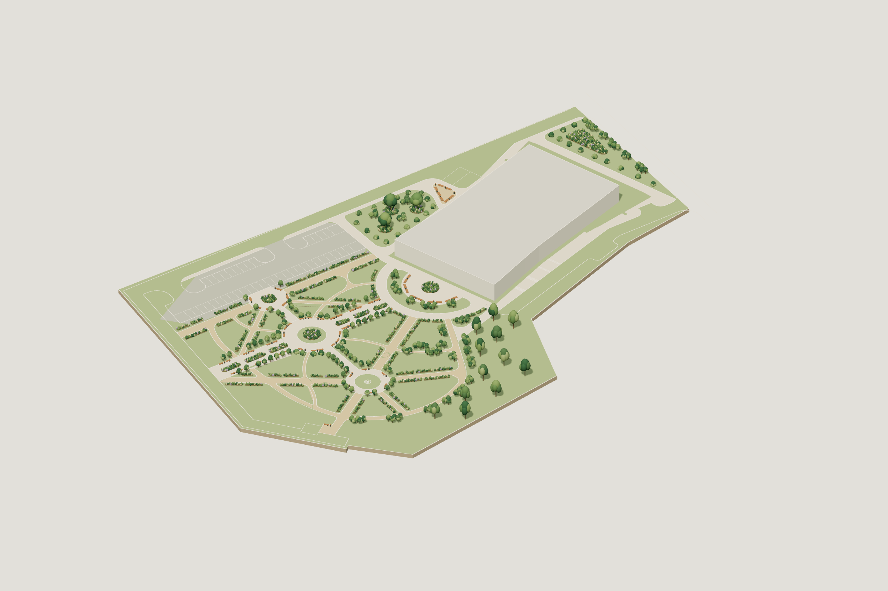

# 园林平面 · 三维模型

基于 [DWG Models / Landscaping plan](https://dwgmodels.com/722-landscaping-plan.html) 原始 CAD 坐标建立的可交互园林模型。

[打开 GitHub Pages](https://caiseyingzi.github.io/landscape-cad-722/)

## 查看与下载

- 拖动旋转、滚轮缩放、右键平移；可切换斜俯视、正俯视和另一侧。
- 可切换图层、调整植物透明度和假定建筑高度，正俯视支持 CAD 线叠加。
- 页面可导出当前显示的 GLB 和 2400 × 1600 PNG。
- [GLB 模型](模型/园林模型.glb)
- [OBJ 与材质压缩包](模型/园林OBJ模型.zip)，解压后将 OBJ 和 MTL 放在同一目录。
- [原始 DWG](参考/landscaping_plan.dwg)
- [正俯视图](预览/02-正俯视.png)

## 依据与假定

源 DWG 的毫米单位按 0.001 换算为米。模型保留园路曲线、圆形节点和 236 个植物符号中心；66 处座椅及 43 处圆形配套小品依平面符号解释。

建筑使用源文件内部闭合轮廓，初始高度暂取 6.6 米。植物冠形、株高、材质、座椅竖向尺寸，以及部分停车铺装范围属于建模假定。模型用于空间表达，不代表已确认的施工尺寸或苗木规格。

导出的 GLB 已使用 Three.js GLTFLoader 重新读取，模型边界一致；浏览器实际导出与预置 GLB 的几何缓冲区一致。

## 部署

这是已构建的静态站点目录。GitHub Pages 使用 `main` 分支根目录发布；`.nojekyll` 禁用 Jekyll 转换，不需要安装服务端运行时。

站点无分析或遥测代码。Three.js 0.180.0 使用 MIT 许可证，详见 [第三方许可](THIRD_PARTY_NOTICES.md)。原始 CAD 和原站预览保留来源信息，未对原图另行声明开放许可。
